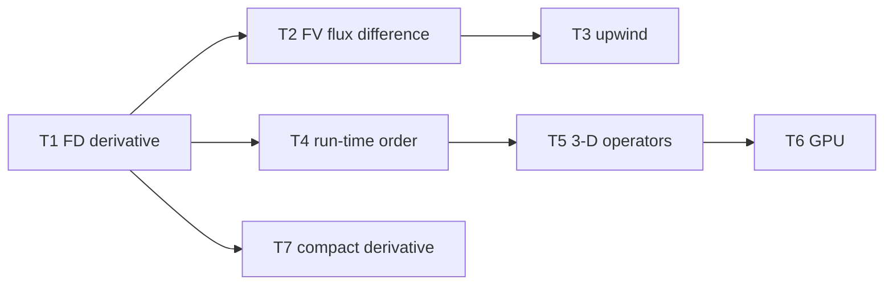

# Tutorials

Seven complete programs, one per tutorial, in `docs/examples/src/`. The code on these pages is that file, included when
the site is built, and the output below it is what the program printed: `bash scripts/run_examples.sh` builds every
program, runs it and fails when its output differs from `docs/examples/output/<program>.txt`.

| Tutorial | You learn | Program |
|---|---|---|
| [T1 A derivative on a periodic grid](./fd-derivative) | the window by offset, ghost nodes, the order measured by halving the step | `fd_derivative.F90` |
| [T2 Finite volumes, conservatively](./fv-flux-difference) | cell averages, face values as fluxes, the cell derivative as their difference, why the sum telescopes | `fv_flux_difference.F90` |
| [T3 Upwind faces and their mirror](./upwind) | right- and left-side stencils, the mirror identity, upwind face values for $u_t + a u_x = 0$ | `upwind.F90` |
| [T4 The order at run time](./run-time-order) | the dispatchers, window bounds as expressions of the order, `GIDEON_NAN`, the cost of choosing per point | `run_time_order.F90` |
| [T5 Gradient, divergence, curl](./operators-3d) | gathering directional stencils from 3-D arrays; the four 3-D operators against exact values | `operators_3d.F90` |
| [T6 On the GPU](./gpu) | the kernels inside `!$acc parallel loop`, the OpenACC build, the device against the host | `gpu.F90` |
| [T7 A compact derivative on a periodic line](./compact-derivative) | a compact operator as a right-side kernel plus a band solved along the line; its order and accuracy against the explicit one | `compact_derivative.F90` |



## Prerequisites

- Fortran arrays with lower bounds other than 1, array sections, explicit-shape dummy arguments.
- [Conventions](/guide/conventions): the names `gideon_<data>_<op>_<bias><order>` and the windows by offset. Every
  tutorial applies them; T1 explains them on one kernel.
- gfortran (the outputs were produced with gfortran 16.2) and FoBiS. T6 runs on a GPU with nvfortran (`-acc`, NVIDIA
  HPC SDK; 26.9 here) and an NVIDIA GPU; without them it runs on the host and prints the same.

## Building the examples

```bash
fobis fetch                        # PENF, into src/third_party/
fobis build --mode examples-gnu    # every program of docs/examples/src, into exe-examples/
./exe-examples/fd_derivative
bash scripts/run_examples.sh       # build, run, compare every output with docs/examples/output/
```

A program is compiled as your own would be, against the static library (which carries PENF):

```bash
fobis build --mode static-gnu      # lib/gnu/static/libgideon.a and its modules
gfortran -I lib/gnu/static/mod docs/examples/src/fd_derivative.F90 lib/gnu/static/libgideon.a -o fd_derivative
./fd_derivative
```

`bash scripts/run_examples.sh fd_derivative upwind` checks some programs only; `--write` rewrites their outputs after
a deliberate change. The programs print only what does not depend on the machine: errors to four significant digits,
orders to two decimals, counts and logical checks, never a timing. The check is made with the `examples-gnu` build;
another compiler can differ in the last printed digit of an error.
